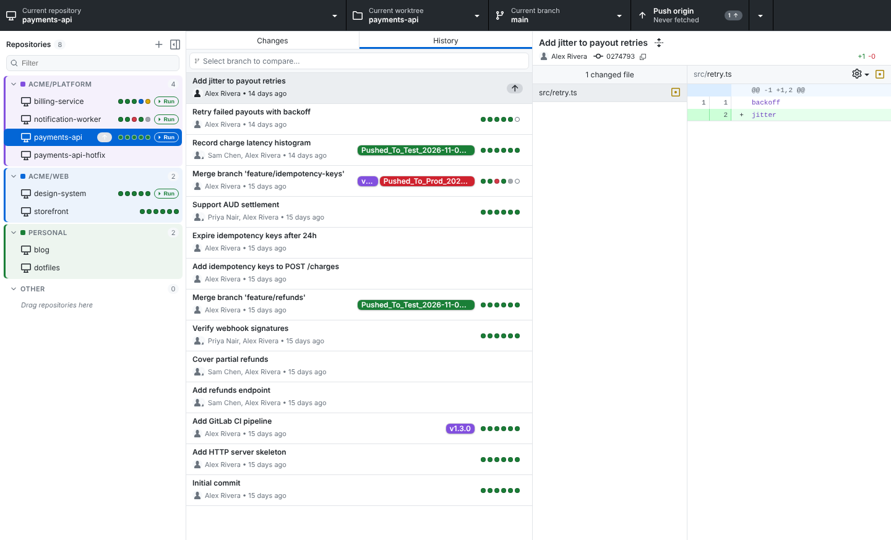
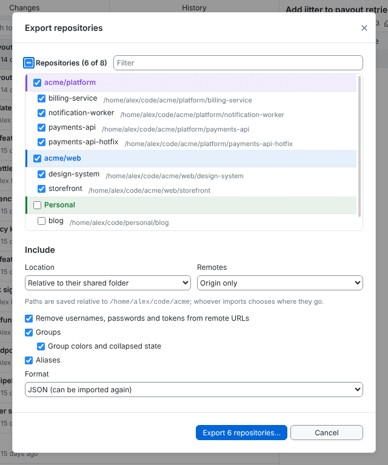
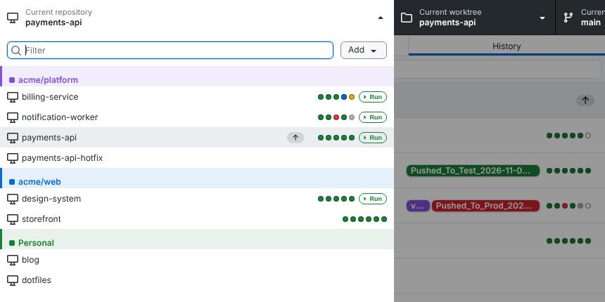
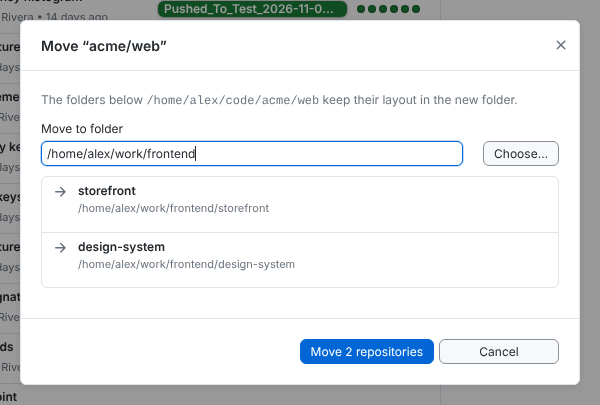
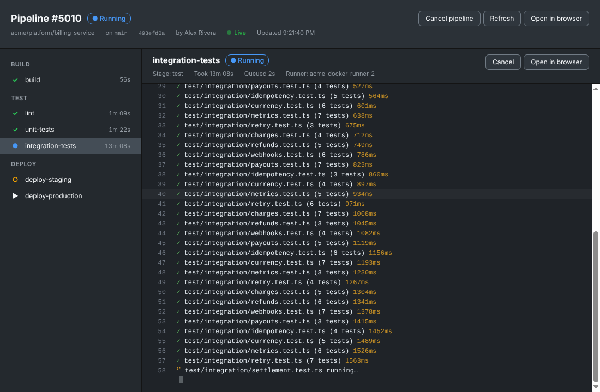
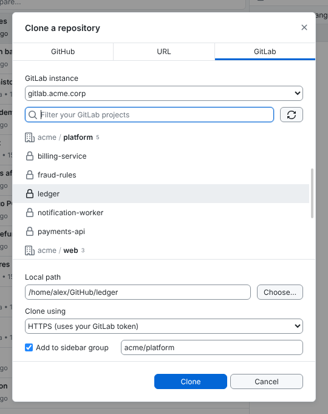
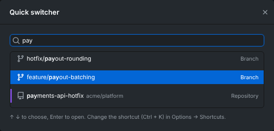
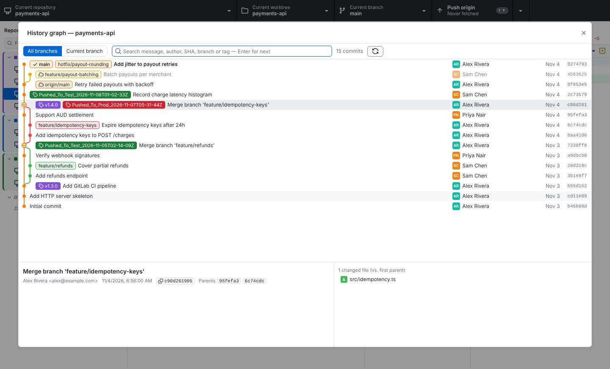
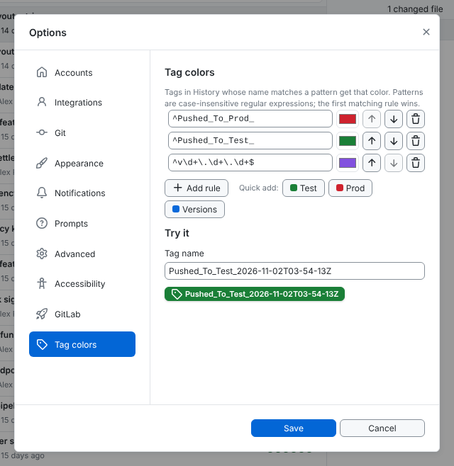
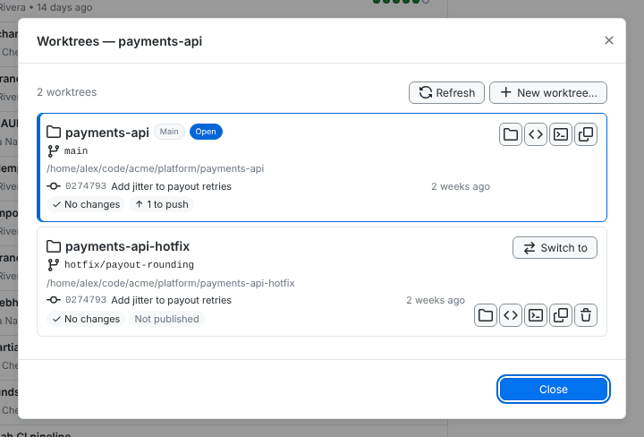

<p align="center"></p>

# GitHub Desktop Custom GitLab CI

A customised build of [GitHub Desktop](https://github.com/desktop/desktop)
with repository groups, GitLab CI/CD pipeline status, a Fork-style history
graph, and other workflow improvements. It installs as a separate app
(**GitHub Desktop Custom GitLab CI**), so it can sit alongside the official
GitHub Desktop. It's an unofficial fork and isn't made by GitHub.
It was called **GitHub Desktop Custom** (repo `Blake-McCullough/desktop`)
until November 2026; existing installs keep their data and update as normal.

<picture>
  <source media="(prefers-color-scheme: dark)" srcset="docs/screenshots/main-window-dark.png" />
  
</picture>

<sub>Screenshots use made-up demo repositories and a test GitLab server.</sub>

**[Download the latest release](https://github.com/Blake-McCullough/github-desktop-custom-gitlab-ci/releases/latest)**

| Platform | Download | Install |
| --- | --- | --- |
| Windows | `GitHubDesktopCustomSetup-x64.exe` | Run it. It isn't code-signed, so SmartScreen will warn you the first time: choose **More info → Run anyway**. |
| Arch Linux, CachyOS, Manjaro, EndeavourOS | `github-desktop-custom-bin-….pkg.tar.zst` | `sudo pacman -U github-desktop-custom-bin-*.pkg.tar.zst` — then launch **GitHub Desktop Custom GitLab CI** from your app menu, or run `github-desktop-custom`. |
| Other Linux | `GitHubDesktopCustomGitLabCI-…-x64.AppImage` | `chmod +x` it and run it. |
| Other Linux (no AppImage) | `GitHubDesktopCustomGitLabCI-…-linux-x64.tar.gz` | Extract and run `github-desktop-custom/github-desktop-custom`. |

On Linux, sign-in and tokens are stored in your keyring, so `libsecret`
(and a keyring such as GNOME Keyring or KWallet) needs to be available —
the Arch package pulls `libsecret` in automatically.

## Updating

The app checks this repository's releases for a newer version shortly after
it starts and every few hours, and shows a banner when one is available.
You can also use **Help → Check for updates…**. **Update now** downloads and
installs the right file for how you installed it, then restarts:

- **Windows** — installs the update with Squirrel (the same updater GitHub
  Desktop uses) while the app is open, then restarts into it. Versions up to
  `3.6.11-custom1-b00013` had a broken Windows updater, so to get past them
  run the latest `GitHubDesktopCustomSetup-x64.exe` by hand once.
- **Arch / CachyOS package** — installs it with `pacman`, asking for your
  password through the desktop's normal prompt.
- **AppImage** — replaces the AppImage file in place.

A copy extracted from the `.tar.gz` can't update itself; the update window
links to the release instead. Automatic checks can be turned off in the
update window.

## Features

### Repositories sidebar

- An always-visible, resizable, collapsible list of your repositories.
- **Groups with colours**: create groups, drag repositories between them,
  and give each group a colour.
- **Filter box** to find a repository quickly (Enter opens the first match).
- Keyboard accessible; collapse or expand all groups from a group's
  right-click menu.

### Import and export repositories

From the sidebar's **+** menu:

- **Export repositories…** saves every repository's location, remotes,
  alias, group and group colour to a JSON file.
- **Export selected repositories…** (also **Export group…** on a group's
  right-click menu) lets you tick which repositories to include and which
  fields: full or relative paths, all remotes / origin only / none, groups
  and their colours, aliases. Usernames and tokens are removed from remote
  URLs by default. Save as JSON (importable) or CSV for a spreadsheet.
- **Import repositories…** reads that file on another computer (or after a
  reinstall). You can choose a new base folder — the folder structure below
  it is kept — and the import adds repositories already on disk, clones the
  missing ones, and recreates your groups.

<p align="center"></p>

### Repository list and sidebar

The **Current repository** list in the toolbar follows your sidebar groups:
the same groups, colors and GitLab pipeline dots (with Run buttons), and its
right-click menu can move a repository to a group. If you prefer the toolbar
list on its own, turn off **Show repositories sidebar** in
**Options → Appearance** (it's on by default).

<p align="center"></p>

### Moving repository folders

Move repositories on disk without breaking anything in the app:

- **One repository**: right-click it → **Move folder…**, then pick or type the
  new location (you can rename the folder too).
- **A group**: right-click the group header → **Move group’s folders…**.
- **Everything**: **+** → **Move all repository folders…**.

Several repositories keep their layout under their shared parent folder (for
example `~/code/work/api` moved to `D:\dev` becomes `D:\dev\work\api`), and
the dialog previews where each one goes. The app's paths, groups, aliases and
settings are updated, linked worktrees are repaired, and repositories nested
inside a moved folder come along. Moving to another drive copies and then
deletes the original. Nothing is overwritten: a move is refused if something
already exists at the destination.

<p align="center"></p>

### GitLab CI/CD pipelines

Set personal access tokens in **Preferences → GitLab** (`read_api` to view,
`api` to also run manual jobs). Each GitLab server has its own token:
gitlab.com, your self-hosted servers, and any found in your repositories are
listed.

- **Sidebar**: a dot per job for the latest commit you've pushed on the
  current branch; running jobs pulse, and clicking a dot opens that job in
  the pipeline window (Ctrl/Cmd-click opens GitLab instead). Manual jobs show
  a **▶ Run** button. Right after a push, the sidebar waits for that commit's
  pipeline rather than showing an older one.
- **History**: a dot per job for every commit; click to open the pipeline.
- **Pipeline graph**: the pipeline window opens on a graph of its jobs,
  like GitHub Actions' run graph: each job is a card with its status and
  time, connected to the jobs it `needs:` (or to the stage before, for
  pipelines without `needs:`). Click a card for its log, or ▶ to run a
  manual job.
- **Test results**: the pipeline window's Tests tab shows the results GitLab
  collected from JUnit XML reports (jobs that list them under
  `artifacts: reports: junit:`), failed tests first with their message and
  stack trace, and the graph marks jobs with failing tests. For .NET `.trx`
  files, convert them to JUnit in CI (e.g. with `trx2junit`).
- **Pipeline window**: the pipeline's jobs by stage and each job's log, with
  colours and collapsible sections like GitLab's own job page. A running
  job's log follows new output live. Select any part of a log to copy it, or use **Copy log** for all of it. Run manual jobs, retry or cancel jobs or
  the whole pipeline, and download artifacts without opening the browser.
- **Notifications**: a desktop notification when the pipeline for a commit
  you pushed passes or fails, or stops at a manual job waiting for you.
  Choose which in **Preferences → Notifications**, and override them for a
  repository under **Repository settings → Notifications**. Clicking one
  opens the pipeline window on the failed or waiting job.
- **Clone from GitLab**: **File → Clone repository → GitLab** lists every
  project your token can see, grouped by GitLab group and subgroup, with a
  filter and an instance picker if you use more than one instance. Cloning
  over HTTPS uses your token, so there's no password prompt. The clone is
  added to a sidebar group named after its GitLab group (you can rename it or
  untick the box).
- **Self-hosted GitLab**: hosts with "gitlab" in the name are detected
  automatically, other servers are detected by asking them, and you can list
  instances (including ones on a sub path) in Preferences.
- **Rate-limit friendly**: one request per project lists recent pipelines
  for every repository and commit, jobs are only re-fetched when a pipeline
  changes, and idle repositories are checked every 5–10 minutes. If GitLab
  rate limits anyway, updates pause until GitLab's reset time and the
  sidebar says when they'll resume.
- **Test** next to each token shows which user and scopes it has on that
  server. A rejected token only pauses that server's pipelines.

<p align="center"></p>

<p align="center"></p>

### Quick switcher and shortcuts

Press **Ctrl+K** (**⌘K** on macOS), or use **View → Quick switcher**, and
type part of a name to jump to another repository or check out a branch of
the current one. Repositories show their sidebar group and colour; recently
used repositories and branches come first. Tick **Repositories only** (in
the switcher or in Options → Shortcuts) to leave branches out.

Every menu shortcut, including the quick switcher's, can be changed in
**Options → Shortcuts** (**Settings → Shortcuts** on macOS): click a
shortcut, press the new keys, and save. Shortcuts used twice are flagged,
and each can be removed or reset to its default.

<p align="center"></p>

### History graph

**View → History graph** (`Ctrl+Alt+G`), or right-click a repository →
**View history graph…**

- All branches (or just the current one) drawn as coloured lanes, with
  merges and branch points connected — similar to Fork.
- Branch labels in their lane's colour, a ✓ on the checked-out branch, a
  cloud when a branch matches its remote, plus remote-only branches and
  tags.
- Commits that aren't on the current branch are dimmed.
- Search by message, author, SHA, branch or tag; keyboard navigation.
- Select a commit to see its full message and changed files.

<p align="center"></p>

### Tag colours

**Preferences → Tag colors** maps regular expressions to colours, e.g.
`^Pushed_To_Test` → green. Matching tags are highlighted in History and the
history graph.

<p align="center"></p>

### Worktrees

Right-click a repository → **View worktrees…** to see every worktree with
its branch, latest commit, uncommitted changes and ahead/behind state, and
to switch to, open, or remove them.

<p align="center"></p>

### Reliability

- If the window's renderer crashes (for example after the computer sleeps),
  the window reloads itself instead of going blank.
- If the app stops responding, you're offered a reload.

## Building it yourself

### Windows

Requirements:

- [Node.js](https://nodejs.org/) — the version in [`.node-version`](./.node-version)
- npm 11.17 or newer: `npm install -g npm@latest`
- Python 3
- Visual Studio 2022 Build Tools with **Desktop development with C++**

```powershell
git clone --recurse-submodules https://github.com/Blake-McCullough/github-desktop-custom-gitlab-ci.git
cd github-desktop-custom-gitlab-ci
npm ci
npm run build:prod
npm run package
```

The installer is written to `dist\GitHubDesktopCustomSetup-x64.exe`, and the
unpacked app to `dist\GitHubDesktopCustom-win32-x64\GitHubDesktopCustom.exe`.

Settings and repository lists live in `%APPDATA%\GitHub Desktop Custom`, so
reinstalling or upgrading keeps them.

### Linux

Requirements: Node.js (the version in [`.node-version`](./.node-version)),
npm 11.17+, Python 3, a C/C++ toolchain, and `libsecret` headers — on Arch /
CachyOS: `sudo pacman -S --needed base-devel python libsecret`.

```sh
git clone --recurse-submodules https://github.com/Blake-McCullough/github-desktop-custom-gitlab-ci.git
cd github-desktop-custom-gitlab-ci
npm ci
npm run build:prod
npm run package
```

This writes to `dist/`:

- `github-desktop-custom-linux-x64/github-desktop-custom` — the app, ready to
  run;
- `GitHubDesktopCustomGitLabCI-<version>-linux-x64.tar.gz` and a `PKGBUILD` next to
  it — on Arch-based systems, `cd dist && makepkg -si` builds and installs a
  pacman package from them;
- an AppImage, if `APPIMAGETOOL` points at
  [appimagetool](https://github.com/AppImage/appimagetool).

Settings live in `~/.config/GitHub Desktop Custom`.

## Releasing

Every push to `main` is released automatically. The **Auto release (main)**
workflow builds the Windows installer, the Linux AppImage and tarball, and an
Arch Linux package on GitHub Actions, and publishes them as a new GitHub
release, usually within 15–20 minutes:

- Version: the `version` in [`app/package.json`](./app/package.json) plus a
  build number, e.g. `3.6.11-custom1-b00042` (tag `v3.6.11-custom1-b00042`).
- Release notes list the commits since the previous release.
- Changes that only touch Markdown files or `docs/` don't trigger a release.
- If several commits are pushed close together, only the newest is built.

To start a new version series (for example after merging a new upstream
release), change `version` in `app/package.json`.

You can also publish a release by hand — **Releases → Draft a new release**
with a new tag — and the **Release (custom build)** workflow will build and
attach the installers to it.

## Keeping up with upstream

```sh
git remote add upstream https://github.com/desktop/desktop.git
git fetch upstream
git merge upstream/development
```

## Privacy

This build doesn't send usage statistics, crash reports or error reports to
GitHub (GitHub Desktop does), and it doesn't check in with GitHub's servers
for feature rollouts. It only talks to the services you use: GitHub or
GitLab for your repositories, GitHub for sign-in and Copilot if you use
them, and this repository's releases for update checks.

## Credits and licence

Based on [GitHub Desktop](https://github.com/desktop/desktop) by GitHub,
released under the [MIT licence](./LICENSE). This build isn't affiliated
with or supported by GitHub.

## Star History

<a href="https://www.star-history.com/?repos=Blake-McCullough%2Fgithub-desktop-custom-gitlab-ci&type=date&legend=top-left">
 <picture>
   <source media="(prefers-color-scheme: dark)" srcset="https://api.star-history.com/chart?repos=Blake-McCullough/github-desktop-custom-gitlab-ci&type=date&theme=dark&legend=top-left" />
   <source media="(prefers-color-scheme: light)" srcset="https://api.star-history.com/chart?repos=Blake-McCullough/github-desktop-custom-gitlab-ci&type=date&legend=top-left" />
   
 </picture>
</a>
